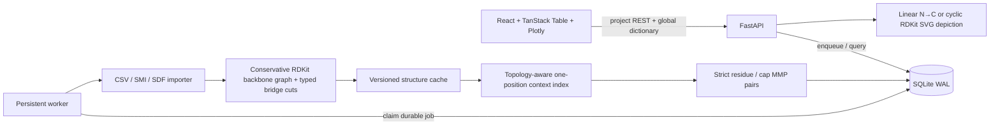

# Architecture

The structure hash is `SHA-256(standardization_version + NUL + canonical isomeric SMILES)`. Decompositions are global by structure and parser version; project membership, source rows, activities, contexts, pairs, jobs, and revisions remain project-scoped.

`sequence_aliases` is a global, non-destructive overlay keyed by residue `variant_hash`. Dictionary entries are derived from representative stored residues, with RDKit fragment SVGs served on demand; bridged non-natural residues have their bridge attachment marked. An edited abbreviation changes sequence rendering in every project and selected-compound CSV without rewriting decompositions or MMP contexts.

The parser finds directed peptide-bond paths or head-to-tail cycles, then virtually cuts peptide and selected bridge bonds. A candidate is accepted only when the cuts partition every atom into residue-anchored components and the original inter-component bonds can be reconstructed. For an N-substituted 1,2,3-triazole bridge, it cuts an exocyclic N–C attachment, leaving all five aromatic ring atoms in one residue fragment and in the linker signature; a pendant triazole is not a bridge. The `cyclization_links` records keep typed endpoints, original atom indices, bond order, alkene E/Z, and linker fragment. Head-to-tail sequence rotation is canonicalized independently of the user's display origin. The parser intentionally sends ambiguous cuts to QC.

The MMP engine first requires an identical topology signature (backbone kind, normalized bridge positions and chemistry). It masks exactly one residue/cap, normalizes cyclic rotations, and indexes the remaining context. A candidate pair is rechecked against residue hashes and bridge signatures; symmetric pairs with no unique changed position are omitted. Stored pairs use sorted structure hashes and are direction-neutral; a client-selected reference controls display direction. Bridge opening, movement, or chemistry changes are never MMPs.

SQLite uses WAL, foreign keys, explicit transactions, and a migration ledger. An import computes chemistry before the database write transaction so the independent worker can publish progress. Snapshot activation, source rows, activity rows, cache references, contexts, pairs, and revision metadata then commit atomically. Parser/MMP version upgrades queue a fresh import from the last accessible completed source while preserving old revisions until the new transaction succeeds.

